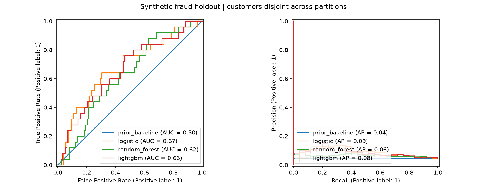
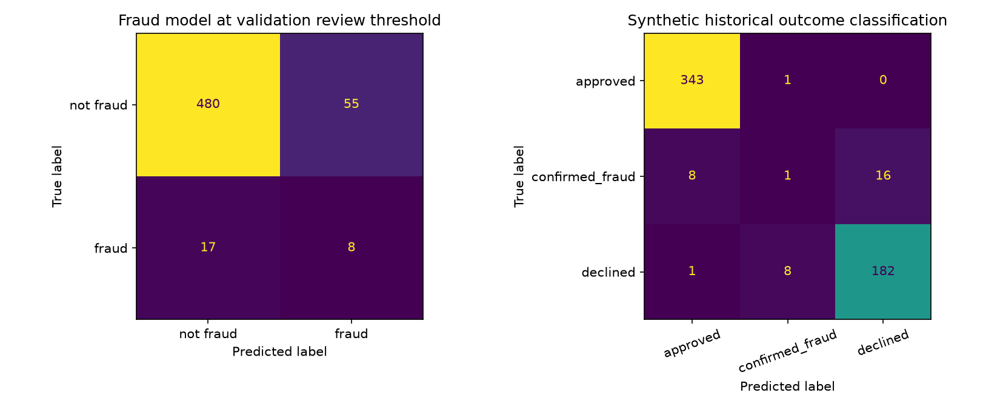
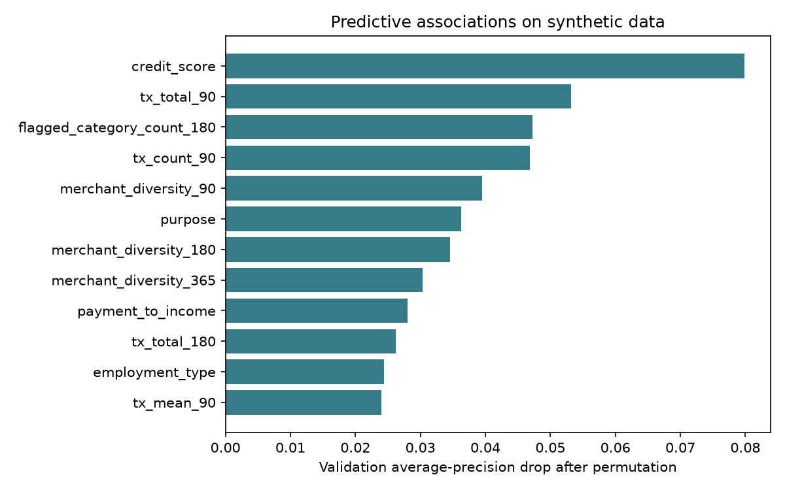
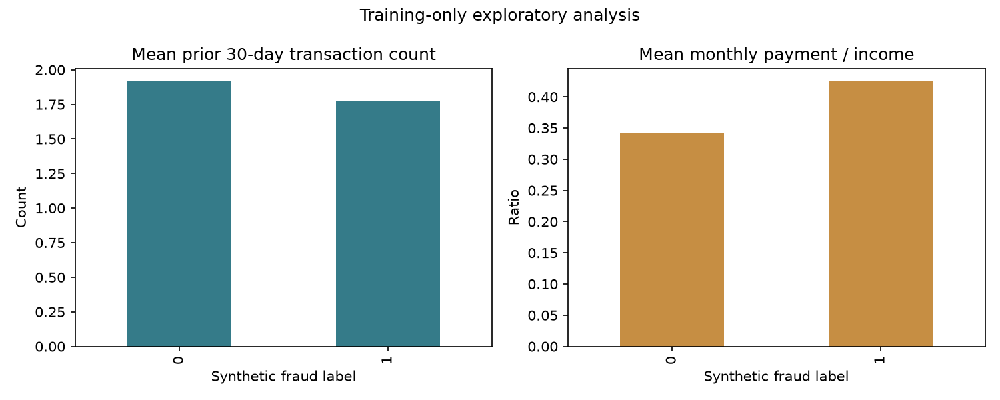

# FraudSignalProject

**Loan fraud detection and risk analytics using application data and transaction history.**

FraudSignalProject builds behavioral and financial features, compares machine learning models, and produces application-level fraud scores and review flags. A secondary classification model analyzes historical case outcomes. The workflow covers feature engineering, class-imbalance treatment, model evaluation, interpretation, and batch prediction.

## Project objectives

- Identify application-level fraud signals from financial profiles and prior transaction behavior.
- Compare logistic regression, random forest, and LightGBM under consistent evaluation conditions.
- Prioritize applications for review using a validation-based capacity threshold.
- Provide reproducible results, feature-importance analysis, and a reusable scoring pipeline.

## Data

The included dataset generator produces **1,400 synthetic customers, 2,800 applications, and 62,651 transactions** with seed 27. Synthetic data supports reproducible experiments without exposing customer records. Dataset definitions and outcome-generation rules are documented in [Methodology](docs/METHODOLOGY.md).

## Modeling workflow

1. **Transaction features:** aggregate counts, total/mean amounts, merchant diversity, and category flags over 30-, 90-, 180-, and 365-day windows before each application.
2. **Financial features:** derive affordability ratios and calendar features from application inputs.
3. **Preprocessing:** impute missing values, apply training-based percentile clipping, standardize numeric predictors, and encode categories.
4. **Imbalance handling:** apply SMOTENC to numeric and categorical training features, followed by one-hot encoding.
5. **Modeling:** compare logistic regression, random forest, and LightGBM against a prior-probability baseline; fit a separate multiclass LightGBM model for case outcomes.
6. **Evaluation:** use customer-disjoint training, validation, and test partitions; select the fraud model by validation average precision.
7. **Scoring:** save the selected pipelines and apply the same feature builder to incoming applications and their transaction histories.

## Results

| Metric | Selected fraud model |
| :--- | ---: |
| Model | Logistic regression |
| Holdout ROC-AUC | 0.674 |
| Holdout average precision | 0.088 |
| Holdout fraud prevalence | 4.46% |
| Review rate at validation-selected threshold | 11.25% |
| Precision / recall at that threshold | 0.127 / 0.320 |

Metrics describe the included synthetic holdout dataset. Full model comparisons, confusion matrices, and verification details are available in [Results](reports/RESULTS.md) and [metrics.json](reports/metrics.json).









## Installation and usage

Requires Python 3.11 or newer.

```sh
python -m venv .venv
# Windows: .venv\Scripts\activate
# macOS/Linux: source .venv/bin/activate
python -m pip install -e .
```

Train, evaluate, and generate reports:

```sh
python -m fraud_signal.cli train --customers 1400 --seed 27 --output reports
```

Score applications using the saved models and generated transaction histories:

```sh
python -m fraud_signal.cli predict
```

Specify your input paths:

```sh
fraud-signal predict --model reports/model.joblib --applications reports/demo_applications.csv --transactions reports/demo_transactions.csv --output predictions.csv
```

Run integrity tests:

```sh
python -m unittest discover -s tests -v
```

The training command creates the input CSVs, model bundle, metrics, and plots. CSV/model artifacts are excluded from Git and can be regenerated locally. Load only trusted joblib artifacts. Tested dependency versions are recorded in `requirements-lock.txt`.

## Output

Each scored application includes its ID, an uncalibrated fraud score, a review flag, and a predicted historical case-outcome class. The validation threshold targets a 10% review budget; ties and changes in score distributions can change the realized review rate.

## Data integrity and evaluation scope

Transactions are aggregated directly from customer histories. Windows include their lower boundary and exclude the application timestamp and future events. All applications for a customer remain in one partition. Preprocessing and oversampling fit only on training data, and model/threshold selection finishes before holdout evaluation.

Scores require separate calibration before interpretation as real-world fraud probabilities. Historical case-outcome labels follow documented synthetic rules; that task measures recovery of those rules. Further validation on representative, lawfully obtained data is needed for operational use, including temporal performance, fairness, monitoring, and policy review.

## Project structure

```text
fraud_signal/features.py     Point-in-time application and transaction features
fraud_signal/simulation.py   Reproducible synthetic data generation
fraud_signal/models.py       Preprocessing, SMOTENC and model pipelines
fraud_signal/evaluation.py   Customer partitions, metrics and review thresholds
fraud_signal/cli.py          Training, reporting and batch scoring
tests/                      Feature, model and data-integrity tests
reports/                    Executed evaluation outputs and figures
docs/                       Methodology and implementation references
```

## Documentation

[Methodology](docs/METHODOLOGY.md) · [Results](reports/RESULTS.md) · [Method references and implementation provenance](docs/PROVENANCE.md)
